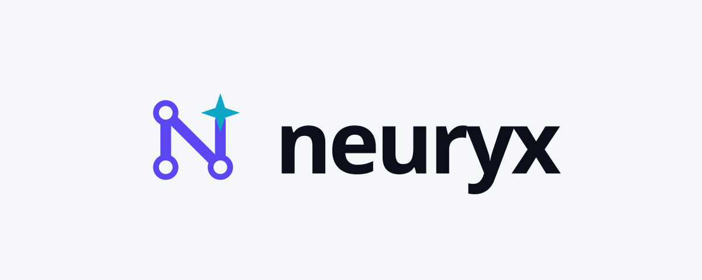

# brand

Identidade visual do Neuryx — logo, ícone, paleta e regras de uso.

**Status:** Em desenvolvimento

<p>
  
</p>

## Conceito

O símbolo é um "N" desenhado como rede neural: três neurônios ligados por
sinapses, com uma estrela de quatro pontas no lugar do quarto neurônio.

- A **rede** representa a inteligência artificial.
- A **estrela** liga o Neuryx ao ecossistema Lyra, que usa nomes de estrelas.

O verde foi evitado de propósito, para que o material do Neuryx não seja
confundido com o da NVIDIA.

## Arquivos

```
brand/
├── TRADEMARK.md                  # política de uso do nome e do logo
├── logo/
│   ├── neuryx-mark.svg           # símbolo, para fundo claro
│   ├── neuryx-mark-dark.svg      # símbolo, para fundo escuro
│   ├── neuryx-icon.svg           # ícone quadrado 512×512 (avatar)
│   ├── neuryx-lockup-light.svg   # símbolo + "neuryx", fundo claro
│   └── neuryx-lockup-dark.svg    # símbolo + "neuryx", fundo escuro
└── palette/
    └── colors.json               # tokens de cor e tipografia
```

## Paleta

| Token | Fundo claro | Fundo escuro | Uso |
| --- | --- | --- | --- |
| `ground` | `#F6F7FB` | `#0B0F1A` | Fundo |
| `ink` | `#0B0F1A` | `#F2F3F8` | Texto e palavra `neuryx` |
| `accent` | `#5B47F0` | `#8B7BFF` | Traços do símbolo |
| `star` | `#0EA5C6` | `#38D6F5` | Estrela |

Os mesmos valores estão em [`palette/colors.json`](palette/colors.json).

## Tipografia

- Fonte: [Space Grotesk](https://fonts.google.com/specimen/Space+Grotesk), peso 600.
- O nome é sempre escrito em minúsculas: `neuryx`.
- `letter-spacing: -0.04em`.

Em texto corrido, o nome do projeto pode ser escrito "Neuryx", com inicial
maiúscula; a forma em minúsculas é a do logotipo.

## Geometria

- **Símbolo:** área de 120×120.
- **Ícone:** área de 512×512; quadrado arredondado de 448×448 centralizado
  (raio 104), preenchido com `#0B0F1A`, contendo o símbolo da versão escura
  com 320×320, centralizado.
- **Lockup:** área de 1200×480; símbolo com 200×200 à esquerda, espaço de
  40 px e palavra `neuryx` em Space Grotesk 600 com 148 px de corpo,
  verticalmente centralizados.

## Regras de uso

- Use a versão clara sobre fundos claros e a versão escura sobre fundos escuros.
- Mantenha ao redor do símbolo uma área livre de, no mínimo, metade da sua largura.
- Não altere as cores, as proporções nem a posição da estrela.
- Não aplique sombras, contornos, gradientes ou efeitos.
- Não use verde no logo nem como cor principal do material do Neuryx.
- Não escreva o logotipo com outra fonte ou em maiúsculas.

O uso do nome e do logo segue a política em [`TRADEMARK.md`](TRADEMARK.md).

## Pendências

- **Converter o texto dos lockups em contornos (paths) antes de uso oficial.**
  Hoje a palavra `neuryx` é um elemento `<text>` com
  `font-family="Space Grotesk, sans-serif"`; sem a fonte instalada, o
  navegador usa outra fonte sem serifa e a largura muda.
- Exportar o ícone em PNG 512×512 para o avatar da organização.

## Relação com outros repositórios

- [`.github`](https://github.com/neuryx-os/.github): o perfil da organização usa os lockups.
- [`site`](https://github.com/neuryx-os/site): usa uma cópia de `neuryx-mark.svg` e a paleta.

## Licença

Este repositório **não** tem licença aberta. Nome e logo são marcas do projeto
Neuryx; veja [`TRADEMARK.md`](TRADEMARK.md).
